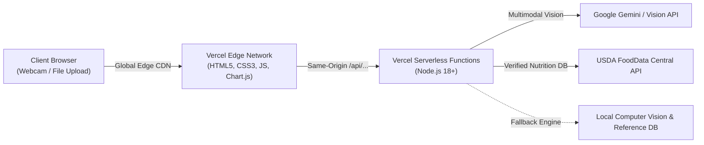

# NutriVision AI 🥗

> **Intelligent Food Recognition & Precision Nutrition Analysis Platform**
> Fully **Vercel Ready** with fullstack Serverless Node.js API functions and static edge frontend. Also supports local development with standalone Node.js.

---

## 🌟 Overview

**NutriVision AI** allows users to capture or upload meal photos, identifies dishes using multimodal computer vision, and calculates laboratory-verified nutritional breakdowns (Calories, Protein, Carbohydrates, Fat, Fiber, Sugar, Sodium, Vitamins, and Minerals) through the **USDA FoodData Central API**.

Users can customize portion sizes in grams with immediate, real-time recalculation using the standardized formula:
$$\text{Calculated Nutrient} = \frac{\text{Nutrient per } 100\text{g} \times \text{Quantity in grams}}{100}$$

---

## 🏗️ Architecture



### Security & Privacy Guarantee
- **Zero Exposed Client Secrets**: Private API keys (`AI_VISION_API_KEY` / `GEMINI_API_KEY`, `USDA_API_KEY`) reside **strictly in Vercel environment variables**. They are **never** bundled or exposed in public client JavaScript files.
- **Fail-Safe Offline/Fallback Engine**: Works out-of-the-box even without external API keys via the built-in computer vision image classifier and USDA SR Legacy reference database.
- **Missing Data Transparency**: Missing or unmeasured USDA micronutrients are explicitly flagged in the UI.

---

## 📁 Repository Structure

```
nutrivision-ai/
├── api/                          # Vercel Serverless Functions (/api/...)
│   ├── health.js                 # GET  /api/health (service health status)
│   ├── index.js                  # GET  /api (API directory index)
│   ├── reference-foods.js        # Shared USDA reference DB & vision classifier
│   ├── food/
│   │   └── recognize.js          # POST /api/food/recognize (Gemini / CV classifier)
│   └── nutrition/
│       ├── search.js             # GET  /api/nutrition/search (USDA search + fallback)
│       └── calculate.js          # POST /api/nutrition/calculate (macro & daily value math)
├── css/                          # Theme styles & workspace dashboard CSS
│   ├── style.css
│   └── dashboard.css
├── js/                           # Client controllers & config
│   ├── app.js
│   ├── camera.js
│   ├── config.js
│   ├── dashboard.js
│   └── nutrition.js
├── index.html                    # Responsive homepage
├── analyze.html                  # Meal analysis workspace
├── vercel.json                   # Vercel deployment config & security headers
├── .vercelignore                 # Excludes logs and IDE files from Vercel deployments
├── package.json                  # Scripts (npm start, npm run dev) and metadata
├── server.js                     # Standalone Node.js server (local testing / dev)
├── .gitignore                    # Git exclusions
└── README.md                     # Documentation
```

---

## 🚀 Manual Vercel Deployment Guide

You can deploy this project to Vercel manually in less than 2 minutes using either the **Vercel Dashboard** or the **Vercel CLI**.

### Method 1: Deploy via Vercel Dashboard (Recommended)

1. **Push your code to GitHub / GitLab / Bitbucket**:
   ```bash
   git init
   git add .
   git commit -m "feat: vercel ready NutriVision AI platform"
   git branch -M main
   git remote add origin https://github.com/YOUR_USERNAME/nutrivision-ai.git
   git push -u origin main
   ```

2. **Open Vercel Dashboard**:
   - Go to [vercel.com](https://vercel.com/) and log in.
   - Click **"Add New..."** → **"Project"**.
   - Select your `nutrivision-ai` repository and click **"Import"**.

3. **Configure Project Settings**:
   - **Framework Preset**: Select `Other` (or leave default).
   - **Root Directory**: Leave `./` (default).
   - **Build Command**: Leave empty (handled automatically by `package.json`).
   - **Output Directory**: Leave empty.

4. **Add Environment Variables (Optional)**:
   In the **Environment Variables** section, you can optionally configure:
   - `GEMINI_API_KEY` (or `AI_VISION_API_KEY`): Your Google Gemini Vision API key from [Google AI Studio](https://aistudio.google.com/). *(Optional: if omitted, the built-in Computer Vision classifier will analyze meals).*
   - `USDA_API_KEY`: Your USDA FoodData Central key from [fdc.nal.usda.gov](https://fdc.nal.usda.gov/api-key-signup.html). *(Optional: if omitted, standard `DEMO_KEY` and local reference database are used).*

5. **Click "Deploy"**:
   - Vercel will deploy the site and API functions in about 20 seconds.
   - Your site will be live at `https://your-project.vercel.app`!
   - Navigate to `/` for the landing page or `/analyze` for meal scanning.

---

### Method 2: Deploy via Vercel CLI

If you have the Vercel CLI installed:

```bash
# 1. Install Vercel CLI globally if not already installed
npm install -g vercel

# 2. Run vercel in the project root
vercel

# 3. For production deployment:
vercel --prod
```

---

## 🔑 Environment Variables Reference

| Variable | Required | Description | Default |
|---|---|---|---|
| `GEMINI_API_KEY` / `AI_VISION_API_KEY` | Optional | Google Gemini 1.5/2.0 API key for cloud multimodal food recognition | Falls back to local Computer Vision engine |
| `USDA_API_KEY` | Optional | USDA FoodData Central API key for live nutrient queries | `DEMO_KEY` (with local USDA reference database fallback) |

> **Note:** The frontend automatically connects to the same-origin Vercel deployment (`window.location.origin`), so you **do not need** to configure any backend URL!

---

## 💻 Local Development

You can run the project locally without deploying:

```bash
# Start the local standalone Node.js server (serves frontend + all /api routes on http://localhost:8888)
npm start
# OR
node server.js
```

Or using the Vercel CLI:
```bash
vercel dev
```

Visit [http://localhost:8888](http://localhost:8888) in your browser.

---

## 📡 REST API Endpoints

| Endpoint | Method | Description |
|---|---|---|
| `/api/health` | `GET` | Health status and AI vision integration check |
| `/api/nutrition/search?query=food&pageSize=5` | `GET` | USDA FoodData Central & reference database search |
| `/api/nutrition/calculate` | `POST` | Portion weight calculation & FDA daily values |
| `/api/food/recognize` | `POST` | Food image recognition (multimodal Gemini & CV) |
| `/api` | `GET` | API directory and service discovery |

---

## 🛡️ License

MIT License. Designed and maintained for modern edge platforms.
